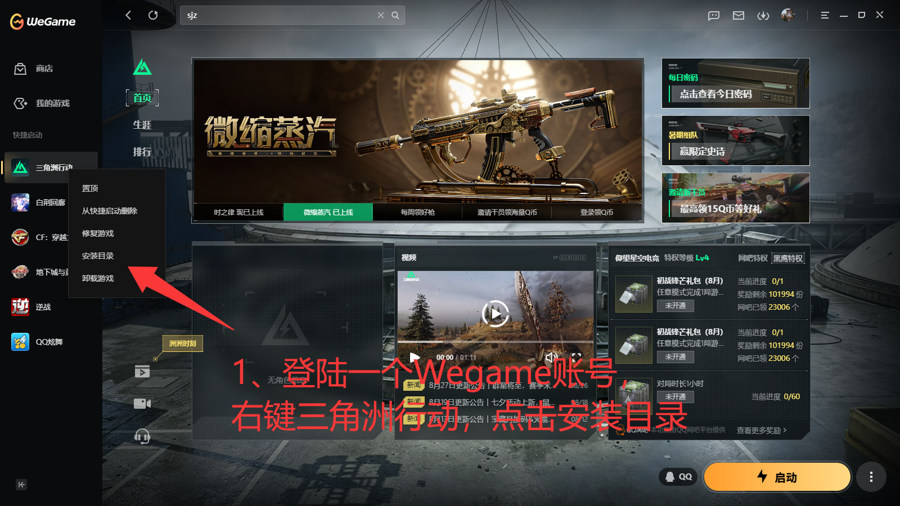

<div align="center">

# delta-force · DAS

**三角洲行动（Delta Force）WeGame 账号自动化套件 — 批量登录 / 验号 / 安装目录定位 / 一键拉起**

<sub>repo: `delta-force` · suite: DAS (Dijia Account Suite)</sub>


</div>

---

## 这是什么

DAS（Dijia Account Suite）是我自己维护的一套 **WeGame 账号批处理引擎**，用来解决"一个人要管几十上百个账号"时的重复劳动：

- **DAS.Login（上号器）** — 读取账号队列，为每个账号拉起独立的 WeGame 登录上下文，自动完成登录动作，登录成功后定位目标游戏的安装目录并交付给下游流程。
- **DAS.Verify（验号器）** — 并发核验账号当前状态（可登录 / 密码错误 / 需要验证 / 被限制），输出结构化报告，支持断点续跑。

两个可执行文件共用同一套本地任务引擎、同一套账号队列格式、同一套日志规范，可以单独用，也可以串成流水线：

```
accounts.txt ──► DAS.Verify ──► report.csv ──► DAS.Login ──► game install dir ──► launcher
                （筛掉坏号）                  （只跑可用号）
```

> 项目定位是 **本机批处理工具**，不做任何服务端、不上传任何数据；所有状态、日志、账号文件都留在本地。

---

## 特性

| | 能力 | 说明 |
|---|---|---|
| ✅ | 队列驱动 | `txt` / `csv` / `json` 三种队列格式，逐行流式读取，百万行不吃内存 |
| ✅ | 并发调度 | 可配置 worker 数与全局速率；单个账号失败不阻塞队列 |
| ✅ | 会话隔离 | 每个账号独立配置目录 + 独立进程树，互不串号 |
| ✅ | 目录定位 | 注册表 + WeGame 本地配置 + 进程命令行 三路探测，命中即缓存 |
| ✅ | 状态判定 | 正常 / 密码错误 / 需二次验证 / 风控限制 / 未知，五态归类 |
| ✅ | 人工介入 | 遇到扫码或短信验证时挂起该任务并落盘现场，人工处理后续跑 |
| ✅ | 断点续跑 | 队列进度落 `state.json`，中断后 `--resume` 继续 |
| ✅ | 结构化日志 | 每账号一条 JSONL 记录 + 控制台摘要 |
| ✅ | 无依赖部署 | 单文件自包含发布，目标机不需要装 .NET 运行时 |

---

## 仓库结构

```
dijia-account-suite/
├─ release/11.16/                 # 已编译产物（自包含单文件）
│  ├─ DAS.Login-11.16-x64.exe
│  └─ DAS.Verify-11.16-x64.exe
├─ src/
│  ├─ DAS.sln
│  ├─ DAS.Core/                   # 队列、调度、状态机、持久化
│  ├─ DAS.Platform/               # WeGame 交互层（窗口、注册表、进程、目录探测）
│  └─ DAS.App/                    # 命令行入口 + 精简 UI
├─ bench/                         # Agent 靶场：样本清单与分析任务
├─ docs/
│  ├─ ARCHITECTURE.md
│  ├─ USAGE.md
│  ├─ FAQ.md
│  └─ assets/
├─ .github/workflows/build.yml
├─ CHANGELOG.md
└─ LICENSE
```

---

## 快速开始

```powershell
# 1. 验号：把不能用的号筛掉，输出报告
.\release\11.16\DAS.Verify-11.16-x64.exe `
    --queue .\accounts.txt `
    --workers 8 `
    --timeout 45 `
    --report .\out\report.csv

# 2. 上号：只跑报告里 status=ok 的账号，登录后定位游戏目录
.\release\11.16\DAS.Login-11.16-x64.exe `
    --queue .\out\report.csv `
    --only-ok `
    --workers 2 `
    --game "三角洲行动" `
    --emit-dir .\out\dirs.json

# 3. 断点续跑
.\release\11.16\DAS.Verify-11.16-x64.exe --queue .\accounts.txt --resume
```

### 队列格式

```text
# accounts.txt —— 支持注释与空行
user1@example.com----pass1
user2@example.com----pass2
```

```json
// accounts.json
[
  { "user": "user1@example.com", "pass": "pass1", "tag": "batch-a" },
  { "user": "user2@example.com", "pass": "pass2", "tag": "batch-b" }
]
```

### 常用参数

| 参数 | 作用 | 默认 |
|---|---|---|
| `--queue <file>` | 队列文件 | 必填 |
| `--workers <n>` | 并发数 | `4` |
| `--timeout <sec>` | 单账号超时 | `60` |
| `--resume` | 从 `state.json` 续跑 | 关 |
| `--only-ok` | 仅处理 `status=ok` | 关 |
| `--report <file>` | 报告输出路径 | `report.csv` |
| `--emit-dir <file>` | 安装目录映射输出 | 关 |
| `--log-level <lvl>` | `trace/debug/info/warn` | `info` |

更多示例见 [docs/USAGE.md](docs/USAGE.md)。

---

## 安装目录是怎么定位的

工具需要知道目标游戏装在哪，才能把目录交给下游启动器。DAS 走三路探测，命中即停：

1. **注册表** — `HKCU\Software\Tencent\WeGame\*` 与 `HKLM\SOFTWARE\WOW6432Node\Tencent\WeGame\*` 下的安装项；
2. **本地配置** — WeGame 安装根目录下的 `*.cfg` / `*.ini`，解析游戏条目的 `InstallPath`；
3. **进程命令行** — 目标进程已在运行时，直接读 `Win32_Process.CommandLine` 反推根目录。

命中结果写进 `dirs.json`，下次直接复用。截图示意：

<div align="center">
  
</div>

---

## 架构

```
┌─────────────────────────────────────────────────────────┐
│ DAS.App            CLI 解析 · 进度条 · 摘要输出          │
├─────────────────────────────────────────────────────────┤
│ DAS.Core           Queue → Scheduler → AccountStateMachine│
│                    · 重试/退避 · state.json · JSONL 日志  │
├─────────────────────────────────────────────────────────┤
│ DAS.Platform       WindowDriver · ProcessGuard ·         │
│                    RegistryProbe · DirResolver           │
└─────────────────────────────────────────────────────────┘
```

- 调度器是**令牌桶 + 有限并发**，`--workers` 控制并发，全局 QPS 由 `--rate` 兜底；
- 状态机五态：`Pending → Running → (Ok | BadCred | NeedsHuman | Blocked | Unknown)`；
- 所有平台交互集中在 `DAS.Platform`，换 WeGame 版本时只改这一层。

细节见 [docs/ARCHITECTURE.md](docs/ARCHITECTURE.md)。

---

## 构建

需要 VS 2022 / .NET 6 SDK（x64）：

```powershell
dotnet publish src\DAS.App\DAS.App.csproj -c Release -r win-x64 `
    -p:PublishSingleFile=true -p:SelfContained=true `
    -p:EnableCompressionInSingleFile=true `
    -o release\11.16
```

产物即 `release/11.16/` 下两个自包含 exe；`DAS.Login` 与 `DAS.Verify` 通过 `--mode login|verify` 共用同一份宿主，构建时以不同入口参数固化为两个文件（方便分发和分权）。

CI：[.github/workflows/build.yml](.github/workflows/build.yml)（push 到 `main` 或打 tag 触发自包含构建）。

---

## 发布产物（11.16）

| 文件 | 大小 | SHA-256 |
|---|---|---|
| `DAS.Login-11.16-x64.exe` | 50.56 MB | `C7D0B569A56BB9DAEF47C5FEBA2A23E3520CC77371F3E1554EADC255AD82CADC` |
| `DAS.Verify-11.16-x64.exe` | 50.67 MB | `6B95BCD6C9C8909C10E9FEFB33B2348642B2F87F652DE0EE8C6D6507E6F4B33F` |

> 单文件自包含发布，体积主要来自内嵌运行时；对外分发用这两个文件即可，不需要附带任何 dll。

---

## Agent 靶场（bench/）

本仓库同时作为**二进制分析靶场**使用：`release/11.16/` 的两个加壳产物用作 Agent 评测样本，任务与评分口径见 [`bench/tasks.md`](bench/tasks.md)，样本清单见 [`bench/targets.json`](bench/targets.json)。

```powershell
# 靶场入口示例：给定样本，产出分析报告
bench\run.ps1 -Target release\11.16\DAS.Login-11.16-x64.exe -Out out\login-report.md
```

靶场只读运行、不落任何账号数据，样本哈希固定，便于回归对比。

---

## Roadmap

- [x] 队列流式读取 + 断点续跑
- [x] 三路目录探测与缓存
- [x] 五态归类与 JSONL 日志
- [ ] 队列分片（多机并行时按 hash 分桶）
- [ ] 目录探测插件化（支持非 WeGame 平台）
- [ ] 报告可视化（单页 HTML）

## 更新记录

见 [CHANGELOG.md](CHANGELOG.md)。11.16 主要修了并发下窗口句柄串号、目录探测在中文路径下的截断问题。

## 许可

MIT © 2026 Dijia — 见 [LICENSE](LICENSE)。

## 说明

- 仅在本机使用：不联网、不上报、不写注册表以外的地方；
- 账号文件与日志都是本地明文，注意别把 `accounts.txt`、`state.json`、`logs/` 提交进仓库（`.gitignore` 已处理）；
- 使用前请自行确认账号来源与目标平台的服务条款，风险自担。
